

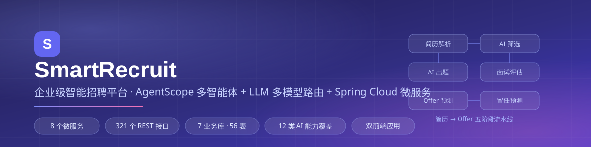

# SmartRecruit · 企业级智能招聘平台

**AgentScope 多智能体 + LLM 多模型路由 + Spring Cloud 微服务**

把 AI 真正嵌进招聘业务链路 —— 简历解析、智能筛选、AI 出题、多智能体面试评估、Offer/留任预测、人才推荐，覆盖「职位 → 简历 → 面试 → Offer → 合同 → 入职」全生命周期，而不是外挂一个聊天框。

[架构设计](#-系统架构) · [功能总览](#-核心功能) · [AI 能力](#-ai-能力全景) · [系统截图](#-系统截图) · [工程亮点](#-工程设计亮点) · [代码导览](#-面试官代码导览)

> ⚠️ **本仓库为技术展示版（Monorepo）**：后端 + HR 管理端 + 招聘官网三端聚合。配置全部改为环境变量占位，数据库脚本与 AI 提示词不随仓库提供，无法开箱运行，仅用于源码阅读与技术评审。

---

## 📦 目录导航

| 目录 | 内容 | 规模 |
|---|---|---|
| [`backend/`](./backend) | Spring Cloud 微服务后端（8 个 Maven 模块） | 745 个 Java 文件 · 321 个 REST 接口 · 7 业务库 · 56 表 |
| [`admin-web/`](./admin-web) | HR 招聘管理端（Vue 3 + TS + Element Plus） | 18 个业务模块 · 66 个页面组件 |
| [`careers-web/`](./careers-web) | 招聘官网 / 候选人门户（Vue 3 + TS） | 职位投递 · 免登录测评 · 合同电子签 |

> 三端亦可分别查看独立仓库：[smart-recruit-backend](https://github.com/birdger/smart-recruit-backend) · [smart-recruit-admin](https://github.com/birdger/smart-recruit-admin) · [smart-recruit-careers](https://github.com/birdger/smart-recruit-careers)

---

## 🏗 系统架构

**设计原则**：数据库-per-服务（7 库彻底解耦）→ 服务间 `@HttpExchange` 声明式调用 → 认证收敛网关，下游零感知。

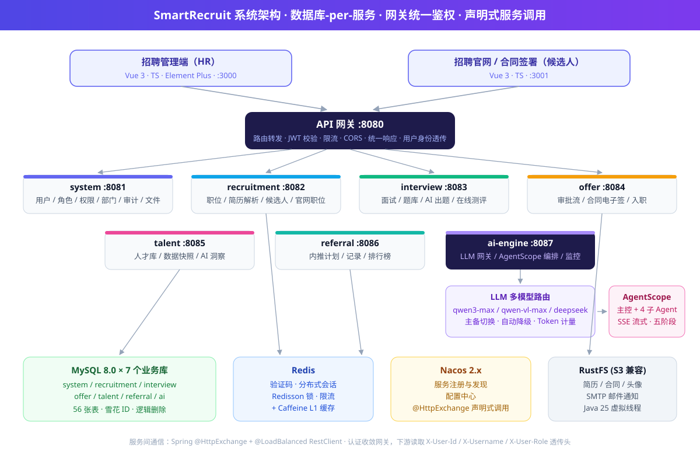

<b>模块与端口清单（点击展开）</b>

| 模块 | 服务名 | 默认端口 | 职责 |
|---|---|---|---|
| `smart-recruit-common` | — | — | 统一响应体、异常体系、DTO/VO、公共配置 |
| `smart-recruit-gateway` | smart-recruit-gateway | 8080 | 统一入口、路由转发、JWT 校验、限流、CORS |
| `smart-recruit-system` | smart-recruit-system | 8081 | 用户/角色/权限/部门、登录验证码、审计日志、文件存储 |
| `smart-recruit-recruitment` | smart-recruit-recruitment | 8082 | 职位、简历解析、候选人、投递流转、官网职位 |
| `smart-recruit-interview` | smart-recruit-interview | 8083 | 面试安排、题库、AI 出题、在线测评 |
| `smart-recruit-offer` | smart-recruit-offer | 8084 | Offer 审批流、合同电子签章、入职管理 |
| `smart-recruit-talent` | smart-recruit-talent | 8085 | 人才库、数据分析快照、AI 洞察 |
| `smart-recruit-referral` | smart-recruit-referral | 8086 | 内推计划、记录、排行榜 |
| `smart-recruit-ai-engine` | smart-recruit-ai-engine | 8087 | LLM 网关、AgentScope 多智能体、Agent 监控 |

<b>技术栈明细（点击展开）</b>

| 分类 | 选型 | 版本 |
|---|---|---|
| 语言/运行时 | Java（虚拟线程 + preview） | 25 |
| 后端框架 | Spring Boot / Spring Cloud / Spring Cloud Alibaba | 4.1.0 / 2025.1.2 / 2025.1.0.0 |
| 网关 | Spring Cloud Gateway（WebFlux） | 5.0.2 |
| ORM | MyBatis-Plus（雪花 ID、逻辑删除、JSON TypeHandler） | 3.5.16 |
| 数据库/缓存 | MySQL 8.0 · Redis + Redisson · Caffeine 两级缓存 | 8.0 / 3.44.0 / 3.2.1 |
| AI | LangChain4j（LLM 网关）· AgentScope（多智能体编排） | 0.29.1 / 2.0.0 |
| 大模型 | 通义千问 qwen3-max / qwen-vl-max · DeepSeek | — |
| 文档解析 | Apache Tika · POI · Mammoth | 2.9.2 / 5.4.1 / 1.12 |
| 鉴权 | JJWT（网关 + 服务双端校验） | 0.12.6 |
| 前端 | Vue · TypeScript · Vite · Element Plus · Pinia | 3.5 / 5.5 / 6.0 / 2.9 / 2.2 |
| 可视化 | Chart.js · signature_pad · mammoth（Word 预览） | 4.4 / 5.1 / 1.12 |
| 工程化 | Knife4j (OpenAPI3) · Nacos 2.x · Maven 多模块 | 4.5.0 |

---

## 🖼 系统截图

<table>
  <tr>
    <td width="50%">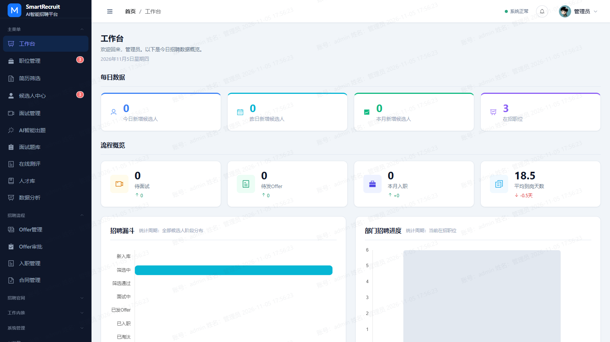 <b>工作台</b> — 每日数据、流程概览、招聘漏斗、部门进度</td>
    <td width="50%">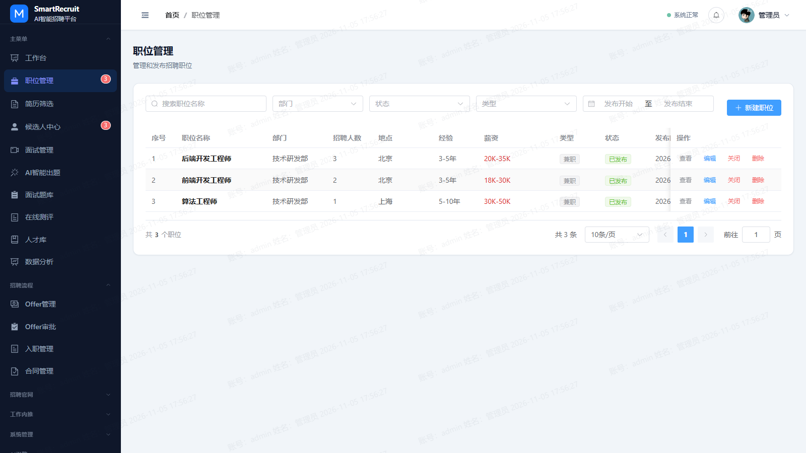 <b>职位管理</b> — 全生命周期 + AI 生成 JD</td>
  </tr>
  <tr>
    <td>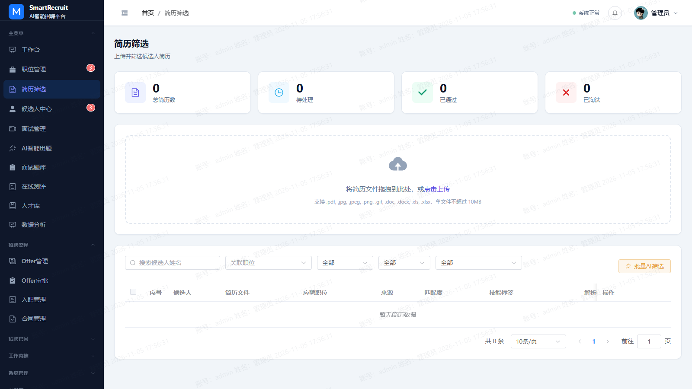 <b>简历筛选</b> — 多格式解析 + 批量 AI 智能筛选</td>
    <td>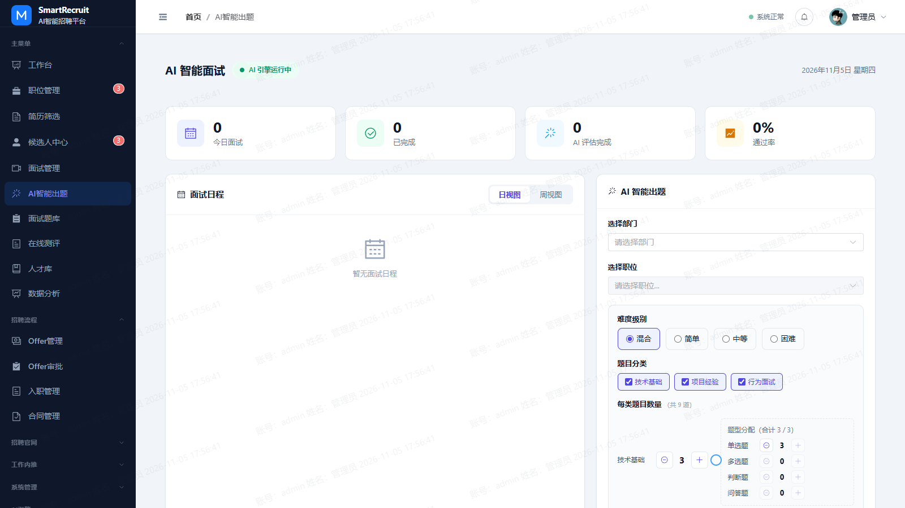 <b>AI 智能出题</b> — 按岗位方向异步生成三类题目</td>
  </tr>
  <tr>
    <td>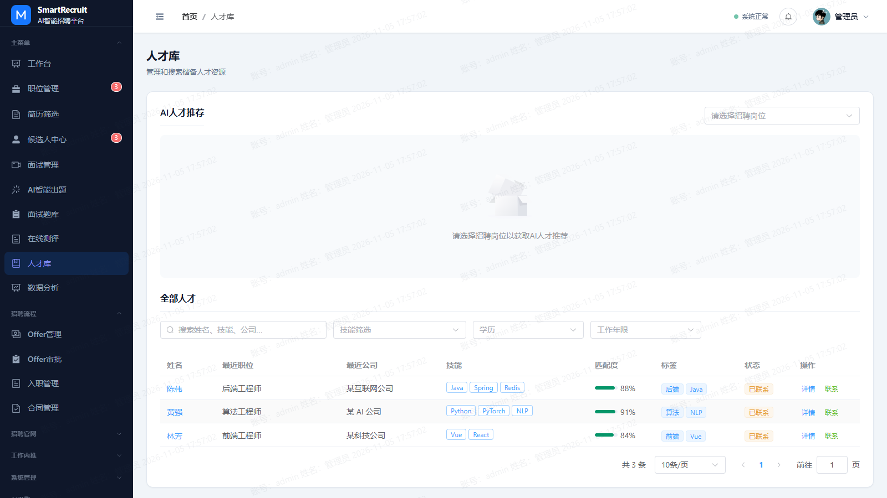 <b>人才库</b> — AI 人才推荐 + 匹配度标签</td>
    <td>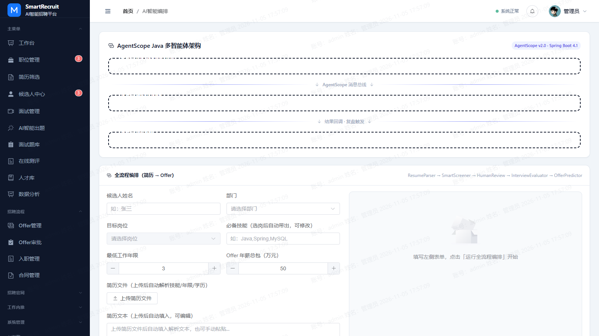 <b>AgentScope 编排台</b> — 简历→Offer 五阶段流水线</td>
  </tr>
  <tr>
    <td>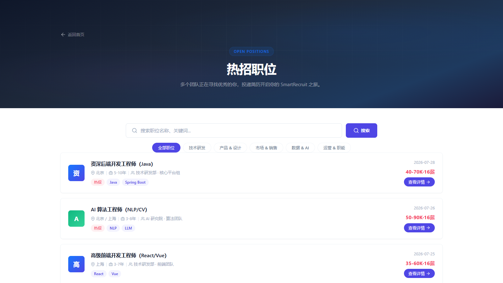 <b>招聘官网</b> — 职位浏览与投递（候选人视角）</td>
    <td>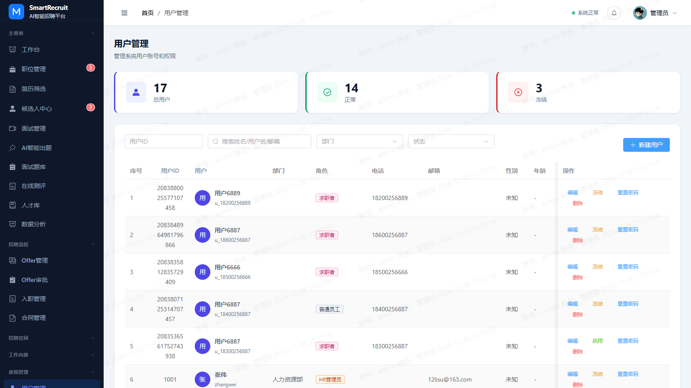 <b>用户管理</b> — RBAC 三级权限 · 审计 · 水印</td>
  </tr>
  <tr>
    <td>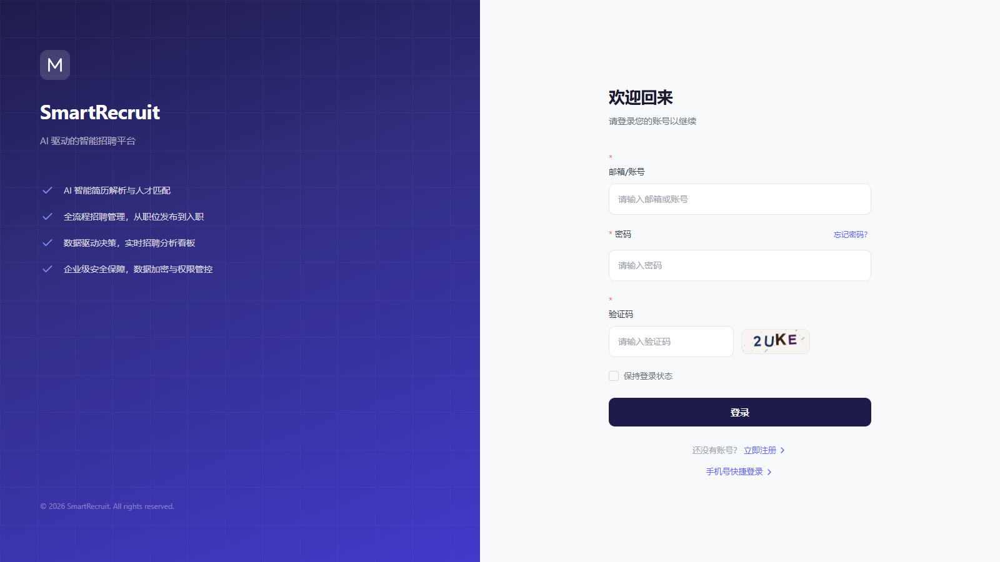 <b>登录</b> — 图形验证码 + JWT</td>
    <td></td>
  </tr>
</table>

---

## ✨ 核心功能

### 招聘主流程

- **职位管理**：草稿 → 发布 → 暂停 → 关闭全生命周期；AI 异步生成 JD（职责 / 要求 / 加分项）
- **简历处理**：PDF / DOCX / DOC 走 Tika 提取 → LLM 结构化（技能、经历、项目、教育）；图片与扫描件自动切换视觉大模型；解析失败自动标记人工复核
- **候选人中心**：档案、来源渠道、阶段历史，与简历 / 面试 / Offer 全链路关联

### 面试与测评

- 日 / 周视图面试日程、面试官分配、反馈汇总
- **AI 智能出题**：按职位方向（前端 / 后端 / 算法…）异步生成技术 / 项目 / 行为三类题目，可直填题库
- **在线测评**：组卷 → 邮件发放 → 免登录作答 → 自动评分
- **AI 评估报告**：六维度（技能 / 沟通 / 逻辑 / 协作 / 学习 / 抗压），同步与 SSE 流式两种返回

### Offer 与入职

- 多级审批流（按部门配置节点）
- **合同电子签章**：手写签名画板 → 候选人 / HR 双签 → 生效，签署留痕、可作废可打印
- **六步入职流程** + AI 留任预测（流程数据 SHA-256 指纹去重，不重复消耗 Token）

### 人才与数据

- **AI 人才推荐**：按岗位异步匹配，每次 8 人 +「换一批」分页；Redis 15min + Caffeine 5min 双级缓存
- **数据分析**：候选人 / 面试 / Offer 日快照定时预聚合，AI 生成自然语言洞察

### 内推与合规

- 内推计划、令牌分享链接、奖金记录、排行榜、公开内推页
- RBAC 三级权限（菜单 / 按钮 / 接口）· AOP 操作审计（人 / IP / 参数 / 耗时）· 可配置页面水印

---

## 🤖 AI 能力全景

12 类 AI 能力全部走统一 LLM 网关：按 Agent 路由模型、主备切换、失败自动降级、Token 全程计量。

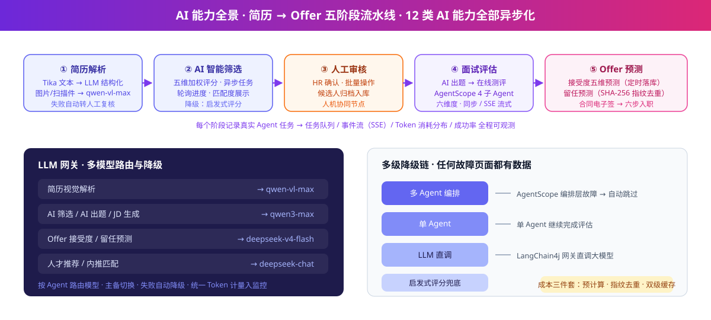

| 能力 | 实现要点 |
|---|---|
| 简历解析（文本 / 视觉） | Tika → LLM 结构化；图片走 qwen-vl-max；失败转人工 |
| AI 智能筛选 | 异步任务 + 轮询进度；降级启发式评分 |
| AI 生成 JD | 异步生成职责 / 要求 / 加分项 |
| AI 智能出题 | 三类题目 × 题型分配，异步 + 轮询 |
| AI 面试评估 | AgentScope 主控 + 4 子 Agent（agent_spawn 协作），同步 / SSE |
| Offer 接受度预测 | 五维预测，定时任务预计算落库 |
| 新员工留任预测 | 入职流程数据 SHA-256 指纹去重 |
| AI 人才推荐 | 双级缓存（Redis 15min + Caffeine 5min） |
| 数据分析 AI 洞察 | 统计结果 → 自然语言解读 |
| 多 Agent 编排 | 简历 → Offer 五阶段流水线，可一键运行 |
| 智能体监控 | 任务队列 / 事件流（SSE）/ Token 分布 / 成功率，全部来自真实调用 |

---

## 🌟 工程设计亮点

1. **微服务真落地** — 8 模块独立部署、数据库-per-服务、Nacos 发现与配置、`@HttpExchange` 声明式调用零手写 HTTP；网关路由收敛 YAML（Gateway 5.x `spring.cloud.gateway.server.webflux.routes`）
2. **网关统一鉴权** — `AuthFilter` 入口完成 JWT 校验，`X-User-Id` / `X-Username` / `X-User-Role` 透传，下游服务零认证代码
3. **LLM 多模型路由** — 按 Agent 路由模型，Qwen / DeepSeek 双厂商主备切换、失败降级，切换模型零业务代码改动
4. **多级降级链** — 多 Agent → 单 Agent → LLM 直调 → 启发式评分，任何故障页面都有数据
5. **全链路异步化** — AI 出题 / 解析 / 筛选 / JD / 推荐全部任务化 + 轮询，页面永不阻塞
6. **成本三件套** — 定时预测落库 · SHA-256 指纹去重 · 双级缓存
7. **数据规范** — 雪花 ID · 逻辑删除 · 审计六件套 · JSON 列 + TypeHandler · 联合索引覆盖查询
8. **前端基础设施** — Axios 拦截（Token 注入 / 401 静默刷新 + 队列重放）、路由懒加载 + 权限守卫、`v-permission` 按钮级权限、水印组件
9. **Java 25 虚拟线程** — AI 异步、SSE、邮件等高 IO 场景虚拟线程化

<b>📷 代码结构图（点击展开）</b>

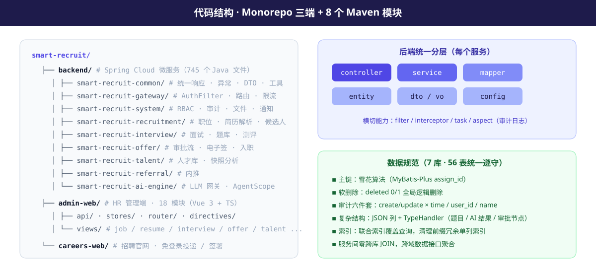

---

## 🧭 面试官代码导览

想快速评估架构与编码能力，建议按以下顺序阅读：

| # | 看什么 | 位置 | 亮点 |
|---|---|---|---|
| 1 | 架构与鉴权 | `backend/smart-recruit-gateway/` | `AuthFilter` JWT 校验 + 用户头透传、白名单、路由配置 |
| 2 | 业务分层规范 | `backend/smart-recruit-recruitment/` | 职位/简历/候选人完整链路，Controller→Service→Mapper |
| 3 | AI 工程 | `backend/smart-recruit-ai-engine/` | LLM 网关路由与降级、AgentScope 编排、五阶段流水线 |
| 4 | 前端工程 | `admin-web/src/utils/` + `router/` | Axios 拦截体系、401 静默刷新 + 请求队列重放、权限守卫 |
| 5 | 公开页设计 | `careers-web/src/views/` | 免登录测评 / 合同签署的令牌鉴权模式 |

---

## 🚀 运行说明

- 各端启动方式见对应目录 README：[`backend/`](./backend#五本地启动) · [`admin-web/`](./admin-web#五本地运行) · [`careers-web/`](./careers-web#五本地运行)
- 依赖：JDK 25 / Maven 3.9+ / MySQL 8.0（7 库）/ Redis / Nacos（可选）/ S3 兼容存储（可选）
- ⚠️ 数据库 DDL、初始化数据、AI 提示词、部署脚本不在公开范围内，仓库**无法直接跑通**，仅用于源码评审

---

## 📄 公开范围与许可

| 项目 | 处理方式 |
|---|---|
| 数据库连接 / Redis / Nacos / 对象存储 / 邮箱账号 | 全部 `${ENV:default}` 占位，仓库内无真实地址与凭据 |
| JWT / 服务间密钥 | 移除默认值，必须环境变量注入 |
| 数据库脚本（DDL + 数据） | 不提供（含演示数据与密码哈希） |
| AI 提示词正文、评测权重细则 | 脱敏为占位说明，保留调用工程结构 |
| Agent 运行时会话日志、部署运维脚本 | 不提供 |

**All Rights Reserved.** 仅授权个人学习与技术评审（面试展示），禁止商用、二次分发、整体或实质性部分转售、作为课程/训练营素材。详见 [LICENSE](./LICENSE)。

---

SmartRecruit — 让 AI 跑在招聘业务的每一个环节 · Built with Java 25 · Spring Cloud · Vue 3

