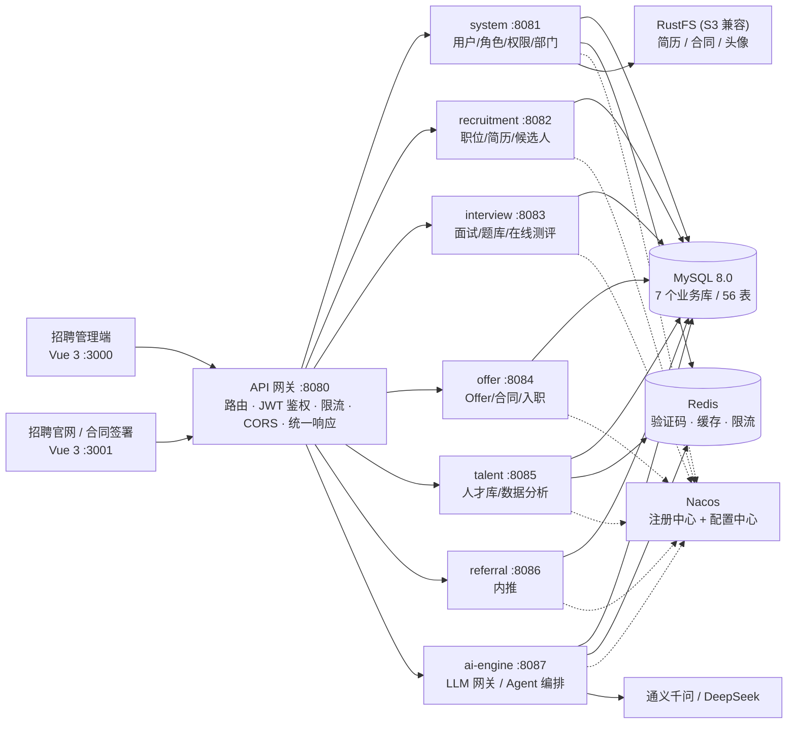

# SmartRecruit · 企业级智能招聘平台（全栈单体展示仓）

> 一句话定位：**AgentScope 多智能体 + LLM 多模型路由驱动的企业级 AI 招聘平台**，
> 覆盖「职位 → 简历 → 筛选 → 面试 → Offer → 合同 → 入职」招聘全生命周期，AI 能力嵌在每一个业务环节，而不是外挂一个聊天框。

> 本仓库为**技术展示版**（Monorepo）：后端 + 管理端 + 招聘官网三端聚合，配置全部环境变量占位、数据库脚本与 AI 提示词不随仓库提供，无法开箱运行，仅用于源码阅读与技术评审。

---

## 一、目录导航

| 目录 | 内容 | 规模 |
|---|---|---|
| [`backend/`](./backend) | Spring Cloud 微服务后端（8 个 Maven 模块） | 745 个 Java 文件 · 321 个 REST 接口 · 7 业务库 · 56 表 |
| [`admin-web/`](./admin-web) | HR 招聘管理端（Vue 3 + TS） | 18 个业务模块 · 66 个页面组件 |
| [`careers-web/`](./careers-web) | 招聘官网 / 候选人门户（Vue 3 + TS） | 职位投递 · 在线测评 · 合同电子签 |

> 三端也可在本人主页分别查看独立仓库：`smart-recruit-backend` / `smart-recruit-admin` / `smart-recruit-careers`。

## 二、整体架构

**架构原则**：数据库-per-服务（7 个库彻底解耦）→ 服务间 `@HttpExchange` 声明式调用 → 认证收敛网关，下游只读 `X-User-Id` / `X-Username` / `X-User-Role` 透传头。

## 三、技术栈

| 层 | 选型 |
|---|---|
| 语言/运行时 | Java 25（虚拟线程 + preview） |
| 后端框架 | Spring Boot 4.1.0 · Spring Cloud 2025.1.2 · Spring Cloud Alibaba 2025.1.0.0 · Gateway 5.0.2 (WebFlux) |
| ORM/存储 | MyBatis-Plus 3.5.16 · MySQL 8.0（7 库 56 表）· Redis + Redisson · Caffeine 两级缓存 · RustFS（S3 兼容） |
| AI | LangChain4j 0.29.1（LLM 网关/多模型路由/降级）· AgentScope 2.0（多智能体编排）· 通义千问 qwen3-max / qwen-vl-max / DeepSeek |
| 前端 | Vue 3.5 · TypeScript 5.5 · Vite 6 · Element Plus 2.9 · Pinia 2 · Axios（401 静默刷新 + 队列重放）· Chart.js · signature_pad · mammoth |
| 工程化 | Knife4j (OpenAPI3) · JJWT 0.12.6 · Nacos 注册+配置 · Tika/POI 文档解析 · Maven 多模块 |

## 四、核心功能（AI × 招聘全流程）

| 环节 | 功能 | AI 能力 |
|---|---|---|
| 职位 | 草稿→发布→暂停→关闭全生命周期 | **AI 生成 JD**（异步，不阻塞页面） |
| 简历 | 上传解析（PDF/DOCX/DOC，**图片/扫描件走视觉模型**），失败自动转人工复核 | **AI 智能筛选**：五维加权评分，异步任务 + 轮询进度 |
| 面试 | 日/周日程、面试官分配、反馈汇总 | **AI 智能出题**（技术/项目/行为三类）· **多智能体六维度评估**（AgentScope 主控 + 4 子 Agent，同步/SSE 流式） |
| 测评 | 题库套题管理、在线组卷、免登录作答、自动评分 | 出题可由 AI 直接填充题库 |
| Offer | 多级审批流（按部门配置节点） | **AI 接受度预测**：薪资/匹配/行情/活跃度/品牌五维，定时预计算落库 |
| 合同 | Offer 一键生成 → 手写签名 → 候选人/HR 双签 → 生效，全程留痕 | — |
| 入职 | 六步流程（资料→设备→账号→欢迎→导师→培训） | **AI 留任预测**：流程数据 SHA-256 指纹去重，不重复消耗 Token |
| 人才库 | 归档、标签、唤醒 | **AI 人才推荐**：每次 8 人 + "换一批"分页，Redis 15min + Caffeine 5min 双级缓存 |
| 数据分析 | 候选人/面试/Offer 日快照预聚合 | **AI 洞察**：统计结果生成自然语言解读 |
| 内推 | 计划、令牌分享、记录、奖金、排行榜 | — |
| 系统 | RBAC 三级权限（菜单/按钮/接口）、审计日志（AOP：人/IP/参数/耗时）、页面水印、验证码 | — |
| 可观测 | Agent 任务队列、事件流（SSE）、Token 消耗分布、成功率与健康度 | 全部来自真实调用记录，可追溯到具体业务操作 |

## 五、工程设计亮点

1. **微服务真落地**：8 模块独立部署、数据库-per-服务、Nacos 发现、`@LoadBalanced` RestClient；网关路由收敛 YAML（`spring.cloud.gateway.server.webflux.routes`，Gateway 5.x 前缀）。
2. **LLM 网关多模型路由**：按 Agent 路由模型（简历视觉解析 → qwen-vl-max；筛选/出题/JD → qwen3-max；预测类 → DeepSeek），主备切换、失败自动降级，统一记 Token。
3. **多级降级链**：面试评估（多 Agent → 单 Agent → LLM 直调 → 启发式）、筛选、Offer/留任预测，任何一层故障页面仍有数据。
4. **成本三件套**：定时预测落库 + SHA-256 指纹去重 + 双级缓存。
5. **全链路异步化**：AI 出题/解析/筛选/JD/推荐全部异步任务化 + 前端轮询，页面永不阻塞。
6. **数据规范**：雪花 ID、逻辑删除、审计六件套、JSON 列 + TypeHandler、联合索引覆盖查询。
7. **前端基础设施**：401 静默刷新 + 请求队列重放、路由懒加载 + 权限守卫、`v-permission` 按钮级权限、水印组件。

## 六、面试官导览（推荐阅读顺序）

想快速评估代码质量，建议按以下路径读：

1. **架构与鉴权** → `backend/smart-recruit-gateway/`：`AuthFilter`（JWT 校验 + 用户头透传）、路由配置
2. **业务分层规范** → `backend/smart-recruit-recruitment/`：职位/简历/候选人完整链路，Controller→Service→Mapper 分层
3. **AI 工程** → `backend/smart-recruit-ai-engine/`：LLM 网关路由与降级、AgentScope 多智能体编排、五阶段流水线（提示词正文已脱敏）
4. **前端工程** → `admin-web/src/utils/`（Axios 拦截体系）+ `admin-web/src/router/`（权限守卫）
5. **公开页设计** → `careers-web/src/views/`（免登录测评、合同签署的令牌鉴权模式）

## 七、运行说明

- 各端独立启动说明见对应目录的 `README.md`（`backend/`、`admin-web/`、`careers-web/`）。
- 需要：JDK 25 / Maven 3.9+ / MySQL 8.0（7 库）/ Redis / Nacos（可选，静态路由可替代）/ RustFS 或任意 S3（可选）。
- **数据库 DDL、初始化数据、AI 提示词、部署脚本不在公开范围内**，仓库无法直接跑通，仅用于源码评审。

## 八、公开范围

| 项目 | 处理方式 |
|---|---|
| 数据库连接、Redis、Nacos、对象存储、邮箱账号 | 全部 `${ENV:default}` 占位，仓库内无真实地址与凭据 |
| JWT / 服务间密钥 | 移除默认值，必须环境变量注入 |
| 数据库脚本（DDL + 数据） | 不提供（含演示数据与密码哈希） |
| AI 提示词正文、评测权重细则 | 脱敏为占位说明，保留调用工程结构 |
| Agent 运行时会话日志、部署运维脚本 | 不提供 |

## License

**All Rights Reserved.** 仅授权个人学习与技术评审（面试展示），禁止商用、二次分发、整体或实质性部分转售、作为课程/训练营素材。详见 [LICENSE](./LICENSE)。
