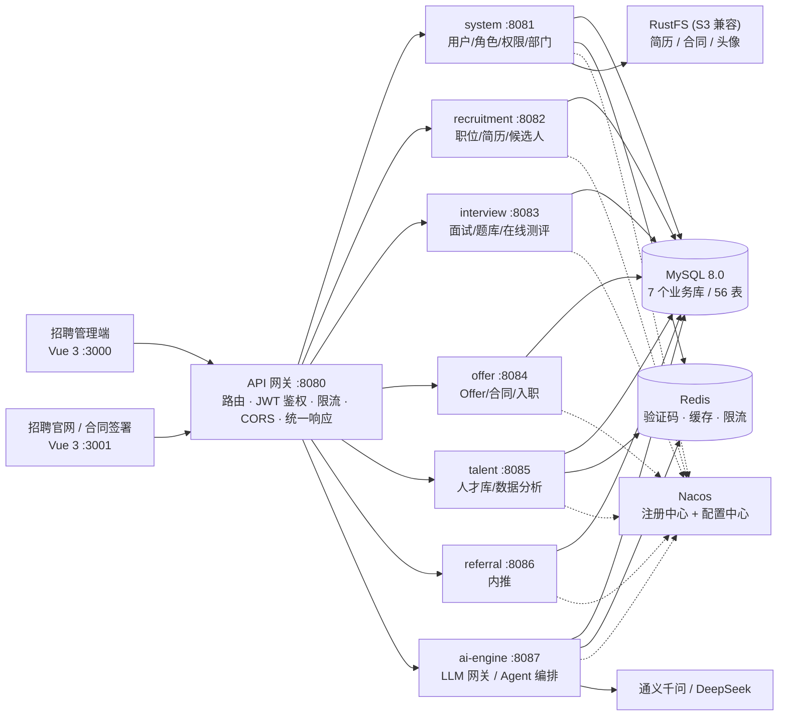

# SmartRecruit · 企业级智能招聘平台（后端）

[](https://openjdk.org/)
[](https://spring.io/projects/spring-boot)
[](https://spring.io/projects/spring-cloud)
[](https://baomidou.com/)

> 基于 **Java 25 + Spring Boot 4.1 + Spring Cloud Alibaba** 的微服务招聘平台后端。
> 8 个 Maven 模块、7 个独立业务库、56 张表、**321 个 REST 接口**，把 AI 能力（简历解析、智能筛选、AI 出题、面试评估、Offer/留任预测、人才推荐）真正嵌进招聘业务链路，而不是外挂一个聊天框。

> ⚠️ **本仓库为技术展示用途**：配置项已全部改为环境变量占位，数据库脚本、AI 提示词与评测权重不随仓库提供。详见文末《关于本仓库的公开范围》。

---

## 一、整体架构



**设计原则**：数据库-per-服务（每个服务独占一个库，数据层彻底解耦）→ 服务间通过 `@HttpExchange` 声明式客户端互相调用 → 认证统一收敛在网关，下游只读 `X-User-Id` / `X-Username` / `X-User-Role` 透传头。

### 模块清单

| 模块 | 服务名 | 默认端口 | 职责 |
|---|---|---|---|
| `smart-recruit-common` | — | — | 统一响应体、异常体系、DTO/VO、工具类、公共配置 |
| `smart-recruit-gateway` | smart-recruit-gateway | 8080 | 统一入口、路由转发、JWT 校验、限流、CORS、统一响应包装 |
| `smart-recruit-system` | smart-recruit-system | 8081 | 用户/角色/权限/部门、登录与验证码、系统配置、通知、审计日志、文件存储 |
| `smart-recruit-recruitment` | smart-recruit-recruitment | 8082 | 职位管理、简历解析、候选人中心、投递流转、官网职位、工作台动态 |
| `smart-recruit-interview` | smart-recruit-interview | 8083 | 面试安排、题库、AI 出题、在线测评、评估报告 |
| `smart-recruit-offer` | smart-recruit-offer | 8084 | Offer 审批流、合同电子签章、入职管理 |
| `smart-recruit-talent` | smart-recruit-talent | 8085 | 人才库、数据分析快照、AI 洞察、聚合工作台 |
| `smart-recruit-referral` | smart-recruit-referral | 8086 | 内推计划、内推记录、排行榜、公开内推页 |
| `smart-recruit-ai-engine` | smart-recruit-ai-engine | 8087 | LLM 网关（多模型路由/降级）、AgentScope 多智能体编排、Agent 监控 |

> 本机多项目共存时可整体改到 8180~8187 段（`--server.port=818x`），网关静态路由见 `smart-recruit-gateway` 的 `application-local.yml`。

---

## 二、技术栈

| 分类 | 选型 | 版本 | 用途 |
|---|---|---|---|
| 语言/运行时 | Java | 25（虚拟线程 + preview） | 高 IO 场景（AI 调用、SSE、邮件）用虚拟线程 |
| 框架 | Spring Boot | 4.1.0 | Web / Validation / Actuator |
| 微服务 | Spring Cloud | 2025.1.2 | Gateway 5.0.2（WebFlux） |
| 微服务 | Spring Cloud Alibaba | 2025.1.0.0 | Nacos 注册 + 配置 |
| ORM | MyBatis-Plus | 3.5.16 | 雪花 ID、逻辑删除、JSON TypeHandler、分页 |
| 数据库 | MySQL | 8.0 | 7 个业务库 |
| 缓存 | Redis + Redisson | — / 3.44.0 | 验证码、缓存、分布式锁、限流 |
| 本地缓存 | Caffeine | 3.2.1 | L1 缓存（5 分钟 TTL），与 Redis 组成两级缓存 |
| 鉴权 | JJWT | 0.12.6 | 网关 + 服务双端校验，共享 secret |
| AI | LangChain4j | 0.29.1 | OpenAI 兼容协议接 Qwen / DeepSeek |
| AI | AgentScope | 2.0.0 | 多智能体编排（interview-evaluator / orchestrator） |
| 文档解析 | Apache Tika / POI / Mammoth | 2.9.2 / 5.4.1 / 1.12 | PDF、DOC、DOCX 简历结构化 |
| 对象存储 | RustFS（S3 兼容） | — | 简历、合同、头像 |
| 接口文档 | Knife4j | 4.5.0 | OpenAPI3 在线调试 |
| 工具 | Lombok / MapStruct / Hutool / Fastjson2 / Guava | — | — |

---

## 三、核心功能

### 3.1 招聘主流程（`recruitment`）

- **职位管理**：草稿 → 发布 → 暂停 → 关闭全生命周期；AI 异步生成 JD（职责 / 要求 / 加分项）。
- **简历解析**：`Tika` 提取文本 → LLM 结构化（技能、经历、项目、教育、优势）；图片/扫描件走视觉模型；解析失败自动标记人工复核。
- **AI 智能筛选**：上传时可选开启，异步执行，前端轮询展示"筛选中 → 完成"与匹配度。
- **候选人中心**：档案、来源渠道、阶段历史，与简历/面试/Offer 全链路关联。
- **官网职位**：`careers` 公开接口，未登录可浏览与投递。

### 3.2 面试与测评（`interview`）

- 日/周视图面试日程，面试官分配、反馈录入、状态流转。
- **AI 智能出题**：按职位方向异步生成（技术 / 项目 / 行为三类），可直接填充套题。
- **题库**：部门 + 职位联动，题型 / 选项 / 答案 / 解析。
- **在线测评**：组卷（AI 出题或题库选题）→ 邮件发放 → 自动评分。
- **AI 评估报告**：多智能体六维度评估（技能 / 沟通 / 逻辑 / 协作 / 学习 / 抗压），同步与 SSE 流式两种返回。

### 3.3 Offer 与入职（`offer`）

- Offer 创建、多级审批流（按部门配置节点）。
- **AI 接受度预测**：定时任务从薪资竞争力、岗位匹配、市场行情、候选人活跃度、雇主品牌五维预测并给建议；已预测不重复调用。
- **合同**：Offer 一键生成合同 → 候选人手写签名 → 候选人/HR 双签 → 生效，支持作废与打印留痕。
- **入职**：六步流程（资料 → 设备 → 账号 → 欢迎 → 导师 → 培训）+ **AI 留任预测**（流程数据 SHA-256 指纹去重，避免重复消耗 Token）。

### 3.4 人才库与数据分析（`talent`）

- 人才池归档、标签、唤醒；**AI 人才推荐**（每次 8 人、"换一批"分页，Redis 15min + Caffeine 5min 双级缓存）。
- 日快照定时预聚合（候选人 / 面试 / Offer），报表直接读快照，避免大表实时统计。
- **AI 洞察**：基于统计结果生成自然语言解读。

### 3.5 内推（`referral`）

内推计划、计划职位、分享链接与令牌、内推记录、奖金记录、排行榜、公开内推页投递。

### 3.6 系统管理（`system`）

RBAC 三级权限（菜单 / 按钮 / 接口）、部门树、登录验证码（Redis）、站内通知 + 邮件、AOP 操作审计（操作人 / IP / 参数 / 耗时）、文件上传下载、系统参数、页面水印配置。

### 3.7 AI 引擎（`ai-engine`）

| 能力 | 实现要点 |
|---|---|
| LLM 网关 | 按 Agent 路由模型（qwen3-max / qwen-vl-max / deepseek-chat），主备切换 + 失败降级，统一记 Token |
| 多智能体 | AgentScope `HarnessAgent` 主控 + 4 个子 Agent 经 `agent_spawn` 协作，SSE 流式输出 |
| 流水线 | 简历 → 筛选 → 人工审核 → 面试评估 → Offer 预测，五阶段可一键运行、逐步留痕 |
| 可观测 | Agent 任务队列、事件流、Token 消耗分布、成功率与健康度，数据全部来自真实调用 |
| 降级链 | 多 Agent → 单 Agent → LLM 直调 → 启发式评分，任何一层故障页面仍有数据 |

---

## 四、工程设计要点

1. **网关统一鉴权**：`AuthFilter` 在入口完成 JWT 校验并注入用户头；白名单可配置（登录、官网、公开合同页）。
2. **声明式服务调用**：`@HttpExchange` 接口即契约，配合 `@LoadBalanced` RestClient + Nacos，零手写 HTTP。
3. **全链路异步化**：AI 出题、简历解析、筛选、JD 生成、人才推荐全部异步任务 + 轮询，页面永不阻塞。
4. **成本三件套**：定时预计算落库、SHA-256 指纹去重、双级缓存。
5. **多级降级**：LLM / Agent / 网络故障均有兜底结果。
6. **数据规范**：雪花 ID、逻辑删除 `deleted`、审计六件套（create/update × 时间 / 人 ID / 用户名）、JSON 列 + TypeHandler、联合索引覆盖查询。
7. **配置驱动路由**：`spring.cloud.gateway.server.webflux.routes`（Spring Cloud Gateway 5.x 前缀），新增服务改 YAML 即生效。

---

## 五、本地启动

### 5.1 前置依赖

| 依赖 | 说明 |
|---|---|
| JDK 25 | 编译需 `--enable-preview` |
| Maven 3.9+ | — |
| MySQL 8.0 | 需自建 7 个库：`smart_recruit_system` / `_recruitment` / `_interview` / `_offer` / `_talent` / `_referral` / `_ai` |
| Redis 6+/7+ | 验证码、缓存、限流 |
| Nacos 2.x | 可选：不启动时用网关静态路由直连各服务 |
| RustFS / 任意 S3 | 可选：文件上传模块需要 |

> 数据库 DDL 与初始数据不在本仓库提供，需自行准备（表结构设计说明见《数据库设计》章节）。

### 5.2 环境变量

复制 `.env.example` 为 `.env` 并填写，或直接导出到系统环境：

```bash
DB_USERNAME=root
DB_PASSWORD=your-db-password
REDIS_HOST=127.0.0.1
REDIS_PASSWORD=
NACOS_SERVER_ADDR=127.0.0.1:8848
NACOS_USERNAME=nacos
NACOS_PASSWORD=
RUSTFS_ENDPOINT=127.0.0.1
RUSTFS_ACCESS_KEY=
RUSTFS_SECRET_KEY=
MAIL_USERNAME=
MAIL_PASSWORD=
JWT_SECRET_KEY=<至少 64 字节的随机串，网关与各服务必须一致>
INTERNAL_JWT_SECRET=<服务间调用密钥>
QWEN_API_KEY=
DEEPSEEK_API_KEY=
```

### 5.3 构建与运行

```bash
mvn -DskipTests clean package

# 逐个启动（示例）
java --enable-preview -jar smart-recruit-system/target/smart-recruit-system-1.0.0-SNAPSHOT.jar
java --enable-preview -jar smart-recruit-recruitment/target/smart-recruit-recruitment-1.0.0-SNAPSHOT.jar
java --enable-preview -jar smart-recruit-gateway/target/smart-recruit-gateway-1.0.0-SNAPSHOT.jar

# 健康检查
curl http://127.0.0.1:8081/actuator/health
```

### 5.4 目录结构

```
smart-recruit-backend/
├── pom.xml                     # 父 POM：版本管理、编译/打包插件
├── .env.example                # 环境变量模板
├── smart-recruit-common/       # 公共模块
├── smart-recruit-gateway/      # 网关
├── smart-recruit-system/       # 系统服务
├── smart-recruit-recruitment/  # 招聘服务
├── smart-recruit-interview/    # 面试服务
├── smart-recruit-offer/        # Offer 服务
├── smart-recruit-talent/       # 人才服务
├── smart-recruit-referral/     # 内推服务
└── smart-recruit-ai-engine/    # AI 引擎
```

每个服务内部统一分层：`controller` → `service/impl` → `repository/mapper` → `entity` / `dto`，横切能力放 `config` / `filter` / `interceptor` / `task`。

---

## 六、数据库设计（摘要）

- **按服务分库**：7 个库、56 张表，服务之间不跨库直连，跨域数据通过接口聚合。
- **主键**：雪花算法 Long，`assign_id`。
- **软删除**：核心表统一 `deleted`（0/1），MyBatis-Plus 全局配置。
- **审计字段**：`create_time` / `update_time` / `create_by` / `create_user_id` / `update_by` / `update_user_id`。
- **扩展字段**：题库题目、AI 结果、审批节点等复杂结构走 JSON 列 + 自定义 TypeHandler。
- **索引**：联合索引覆盖高频查询，避免前缀冗余单列索引。

> 完整 DDL 与初始化数据不在公开仓库中。

---

## 七、关于本仓库的公开范围

为了让面试官能完整评估架构与编码能力，本仓库公开了**全部业务代码**，但同时做了以下处理：

| 项目 | 处理方式 |
|---|---|
| 数据库连接、Redis、Nacos、对象存储、邮箱账号 | 全部改为 `${ENV:default}` 占位，仓库内不含任何真实地址与凭据 |
| JWT 密钥 | 移除默认值，必须由环境变量注入（不注入则启动失败） |
| 数据库脚本（DDL + 初始化数据） | **不提供**（含演示数据与密码哈希），仅在本文档给出设计说明 |
| AI 提示词正文、评测维度权重细则 | 已脱敏为占位说明，保留调用的工程结构 |
| Agent 运行时会话日志（`.agentscope/workspace`） | 不提供（含真实调用记录） |
| 部署脚本、运维手册 | 不提供 |

因缺少数据库脚本与环境变量，本仓库**无法开箱直接运行**，仅用于源码阅读与技术评审。

## License

**All Rights Reserved.** 仅授权用于个人学习与技术评审（面试展示）。禁止商业使用、二次分发、整体或实质性部分转售、以及作为课程/训练营素材使用。详见 [LICENSE](./LICENSE)。
